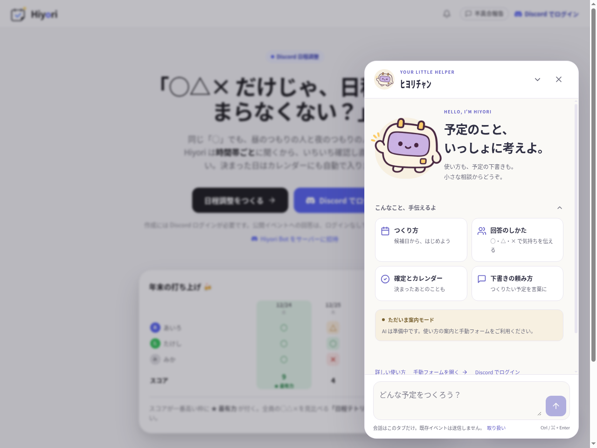
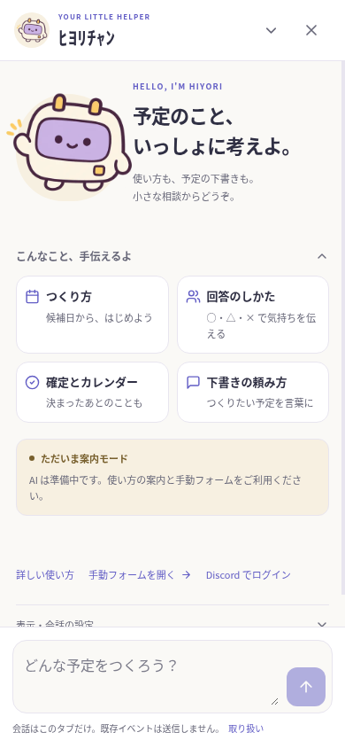
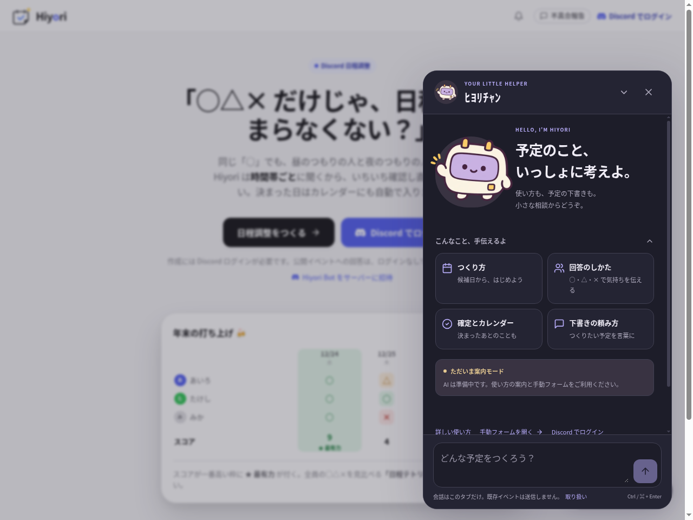
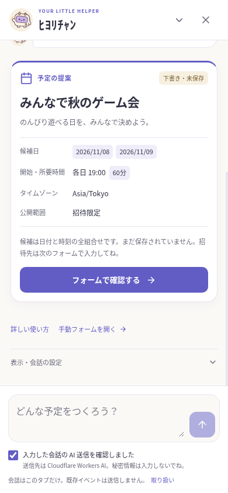

# ﾋﾖﾘﾁｬﾝのキャラクターと UI

採用するのは、2026-10-25 に built-in image_gen で生成した小さなカレンダー型 Bot。丸いボディと表情のある画面、太い輪郭、青紫・クリーム・日差しの金色を使う。原画を実際に目視確認して使用し、透過 PNG をそのまま保存した。顔は絵文字や CSS ではなく実画像。

- [採用 Bot の透過原画 PNG](hiyori-bot-original.png): 1312×1199、約509KB。
- [UI 用 WebP](../../../src/client/assets/images/hiyori-bot.webp): 384×384。透明な余白を整えてリサイズ・形式変換し、アルファ透過を維持。小さなアバターでも全身の輪郭と表情が見えるように表示する。追加依存・外部画像 CDN は使わない。

旧人型案 `hiyori-chan-original.png` は不採用。検討履歴として残すが、UI からは参照しない。以下の画面は採用 Bot に差し替えた後のもの。

## ローカル画面

以下はローカル Chromium で取得した実画面。会話と下書きの画面は合成プロフィール・合成 AI 応答だけを使う。実ユーザーのログインや個人情報、実モデル実行は含まない。スクリーンショットは検証成果物としてこのリポジトリに保持し、Library には保存しない。

| PC・ライト | スマホ・ライト |
|---|---|
|  |  |

| PC・ダーク | スマホ・下書き |
|---|---|
|  |  |

[PC の下書きカード](desktop-draft.png)

[スマホのダーク画面](mobile-dark.png) ／ [小さな起動ボタン](desktop-launcher.png)

マスコットのテーマは OS の light/dark に対応し、既存サイトのグローバルテーマは変更しない。開いた直後は見出しへフォーカスし、スマホのキーボードを勝手に開かない。閉じると起動元へ戻り、Escape とネイティブ dialog のフォーカス制御を使う。Ctrl/⌘+Enter 送信は IME 変換中には動かさない。モバイルは VisualViewport の変化に追従する。

静的案内・ミーム・表示設定、本人確認、下書き確認、ログアウト・アカウント切替時の破棄は維持。認証修正 PR #125 のコードは変更しない。TLS/HSTS/Access/DNS、AI binding、実推論も変更・実行しない。画面改善は危険サイト判定の解消を意味しない。
